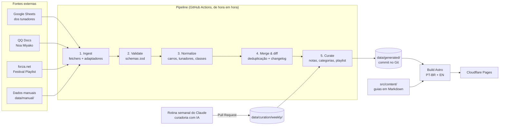

# Arquitetura

> **Status:** rascunho v0.1 · **Atualizado em:** 2026-11-07
> Este documento descreve *como* o sistema funciona. O *porquê* de cada escolha está nos [ADRs](adr/README.md).

## 1. Visão geral

O sistema tem três partes:

1. **Pipeline de dados** (`pipeline/`): lê as fontes externas, valida, normaliza, junta e calcula notas e sugestões. Gera arquivos JSON versionados no Git.
2. **Site** (`src/`): site estático em Astro que lê esses JSONs e o conteúdo editorial (Markdown) e gera as páginas em PT-BR e EN.
3. **Automação** (`.github/workflows/` + rotina do Claude): roda o pipeline de hora em hora, publica o site e, uma vez por semana, enriquece a curadoria da playlist via Pull Request.

Não há servidor nem banco de dados na v1 ([ADR-0002](adr/0002-site-estatico-sem-banco.md)).



## 2. Estrutura de pastas

Itens marcados com ⏳ ainda não existem e entram nas fases seguintes.

```text
fh-hub/
├─ docs/                         # esta documentação
├─ data/                         # dados PÚBLICOS (commitados): só fontes autorizadas (ADR-0010)
│  ├─ sources.yaml               # registro de fontes (ver DATA_SOURCES.md)
│  ├─ manual/
│  │  ├─ car-aliases.yaml        # nome visto numa fonte → id canônico do carro
│  │  ├─ tuner-aliases.yaml      # variações de gamertag → nome canônico do tunador
│  │  ├─ track-aliases.yaml      # nome de pista nas notas (ex.: 白川) → nome em inglês (Shirakawa)
│  │  ├─ translations.yaml       # memória de tradução das notas e nomes em chinês (ADR-0014)
│  │  ├─ playlist-texts.yaml     # desafios da playlist em inglês → português (ADR-0014)
│  │  ├─ tuner-surfaces.yaml     # especialidade de piso de um tunador (ex.: SR1 Rain → terra)
│  │  ├─ base-events.yaml        # ⏳ eventos-base do mapa (levantamento manual)
│  │  └─ zh-labels.yaml          # ⏳ rótulos em chinês da planilha de Noa Miyako (hoje em normalize/fields.ts)
│  ├─ curation/config.yaml       # pesos e regras de curadoria (⏳ weekly/<season-id>.json da IA, via PR)
│  ├─ generated/                 # SAÍDA do pipeline: nunca editar à mão
│  ├─ review/                    # filas de revisão humana (carros não reconhecidos, valores desconhecidos)
│  └─ snapshots/                 # último dado bom de cada fonte pública
├─ .cache/                       # git-ignored
│  ├─ raw/                       # última resposta bruta de cada fonte (depuração, --offline)
│  └─ preview/                   # generated/, review/ e snapshots/ com TODAS as fontes
├─ pipeline/
│  ├─ cli.ts                     # pnpm sync | fixtures:update | validate
│  ├─ commands/                  # sync.ts, fixtures.ts, validate.ts
│  ├─ fetchers/                  # index.ts (google-csv, google-xlsx, forza-net), qq-docs.ts e fhstats.ts
│  ├─ adapters/                  # um arquivo por fonte + types.ts (contrato) + index.ts (registro)
│  ├─ normalize/                 # fields.ts (classe, piso, pneus…), car-resolver.ts, tuners.ts
│  ├─ build/                     # dataset.ts (junta tudo), write.ts (gravação determinística), changelog.ts
│  ├─ curate/                    # config.ts (schema do config.yaml), index.ts (notas, categorias, sugestões),
│  │                             # roles.ts (ranking do Forza Paddock, ADR-0017) e brain-afk.ts (ADR-0018)
│  ├─ schema/                    # schemas zod: fonte única de verdade dos tipos
│  ├─ lib/                       # http, tabelas, markdown, texto, similaridade, JSON estável, protobuf, qq-sheet
│  ├─ testing.ts                 # roda os adaptadores sobre as fixtures (usado nos testes)
│  └─ __fixtures__/              # amostras reais das fontes (ver DATA_SOURCES.md)
├─ src/                          # site Astro
│  ├─ pages/                     # rotas (PT-BR na raiz, EN em /en/)
│  ├─ components/                # páginas e componentes estáticos (.astro)
│  ├─ layouts/                   # Base.astro (cabeçalho, idioma, rodapé)
│  ├─ lib/data.ts                # leitura dos JSON gerados no build
│  ├─ i18n/                      # pt-br.json, en.json + helpers
│  ├─ islands/                   # componentes interativos (Preact): TuneSearch
│  └─ content/                   # ⏳ coleções: guides, accessories, custom-events
└─ .github/workflows/            # ci.yml, sync.yml (⏳ deploy.yml, health.yml)
```

**Um único pacote** (não monorepo): menos configuração e mais fácil para quem herdar. O pipeline e o site compartilham os schemas de `pipeline/schema/`.

## 3. Pipeline em detalhe

O pipeline é uma CLI TypeScript (`pnpm sync`). Cada etapa é, sempre que possível, uma **função pura** (entrada → saída); leitura de rede e escrita em disco ficam nas bordas. Isso torna cada etapa testável com fixtures.

### 3.1 Ingest

Cada fonte declarada em `data/sources.yaml` informa um **fetcher** (como baixar) e um **adaptador** (como interpretar). Detalhes de cada fonte em [DATA_SOURCES.md](DATA_SOURCES.md).

| Fetcher | Como funciona | Observações |
|---|---|---|
| `google-csv` | `GET https://docs.google.com/spreadsheets/d/{id}/export?format=csv&gid={gid}`; se o dono bloqueou a exportação (401/403), `.../gviz/tq?tqx=out:csv&headers=0&gid={gid}` | Funciona sem chave de API para planilhas públicas. O gviz é só plano B porque apaga células que não combinam com o tipo que ele adivinha para a coluna ([DATA_SOURCES](DATA_SOURCES.md#como-as-planilhas-do-google-são-lidas)) |
| `google-xlsx` | `GET .../export?format=xlsx` | Usado quando a **formatação** carrega informação (ex.: a classe na planilha do kleis é a cor da célula). Lido com ExcelJS |
| `qq-docs` | Página da planilha (cookies anônimos; `TOK` = xsrf) → `dop-api/opendoc` (abas e revisão) → `dop-api/get/sheet` por aba. Blobs em base64 → zlib → protobuf não documentado, decodificados em `lib/qq-sheet.ts` | **Fonte mais frágil.** Plano B: navegador headless (Playwright) |
| `forza-net` | `GET https://forza.net/<página>/_payload.json` (payload do Nuxt, serializado com *devalue*) | Roster oficial de carros (`fh6cars`, Fase 0) e playlist (`fh6playlists`, Fase 1). Decodificado com `devalue.unflatten` e *revivers* para os tipos do Nuxt |
| `manual` | Lê YAML de `data/manual/` | Dados curados à mão (eventos-base, aliases) |

**Boas maneiras com as fontes:**
- `User-Agent` identificável (`fh-hub-sync/<versão> (+<url do site>)`).
- No máximo 1 requisição/s por host; no máximo uma sincronização por hora.
- Nunca enviar dados para as fontes, só leitura.

Saída do ingest: registros brutos tipados por fonte, convertidos para uma forma comum (`SourceObservation`) com **proveniência**: `sourceId`, aba, número da linha e `fetchedAt`.

### 3.2 Validate

- Cada adaptador declara os **cabeçalhos esperados**. Se não baterem, a fonte é marcada `degraded`, a etapa é abortada **só para aquela fonte** e os últimos dados bons continuam publicados ([ADR-0005](adr/0005-pipeline-adaptadores.md)).
- Todos os registros passam por schemas zod.
- **Freio de segurança:** se o número de linhas cair mais de 30% em relação à última sincronização boa, as remoções não são publicadas e um alerta é disparado.

### 3.3 Normalize

| Item | Regra |
|---|---|
| Carro | Resolução em cascata (`normalize/car-resolver.ts`): alias manual → nome exato → marca + modelo → subconjunto (todas as palavras do nome cabem em um único carro da mesma marca/ano) → *fuzzy* (mesma marca, similaridade ≥ 0,92 e vencedor claro) → fila de revisão. O ano é extraído de vários formatos: `1991 …`, `… (2023)`, `… '08`, `… 24'`. Ver [ADR-0006](adr/0006-identidade-canonica.md) |
| Tunador | Remove espaços, aplica `tuner-aliases.yaml`, gera slug |
| Classe | `S1`, `S1 800`, `Class S1` → enum `S1`; PI extraído quando presente |
| Piso | `road`, `dirt`, `cross-country`. Modalidades (street, touge, drag, drift) vão num campo separado `discipline` |
| Share code | Só dígitos, exatamente 9; exibido como `123 456 789` |
| Tags de build | `purist`, `stock-look`, `full-aero`, `powerbuild`, `engine-swap`, `drivetrain-swap`, a partir das colunas Build/Comment e de palavras-chave no nome do tune |
| Chinês (Noa) | Dicionário `data/manual/zh-labels.yaml` (ex.: 非常困难 → `very-hard`, 公路 → `road`) |

### 3.4 Merge & diff

- **Tunes com share code** são identificados pelo código. Se várias fontes listam o mesmo código, viram um único tune com várias **observações** (cada uma com sua proveniência).
- **Tunes sem código** (kleis, Letz) são identificados por `(carro, tunador, nome normalizado)` e ligados a um tune com código quando há correspondência.
- O resultado é comparado com o `data/generated/` anterior para gerar o **changelog**: adicionado, removido, tier subiu/desceu, código alterado.
- **Anti-oscilação:** uma remoção só é publicada depois de 2 sincronizações saudáveis seguidas da fonte.

### 3.5 Curate

Calcula a nota de cada tune, as categorias (Meta / Off-meta / Purista / Meme) e as sugestões por evento da playlist. O algoritmo e os pesos estão em [CURATION.md](CURATION.md) e em `data/curation/config.yaml`.
Se existir enriquecimento da IA válido para a semana (`data/curation/weekly/<season-id>.json`), ele é aplicado por cima do resultado das regras.

### 3.6 Publicação dos dados

- **Dois destinos** ([ADR-0010](adr/0010-politica-de-fontes.md)):
  - `data/` (**público**, commitado): o dataset é montado **só** com fontes `granted` ou `not-required`.
  - `.cache/preview/` (**prévia**, git-ignored): o mesmo dataset com **todas** as fontes ativas, para desenvolvimento local (`pnpm dev:preview`).
  - O workflow agendado roda com `--public-only` e nem baixa as fontes pendentes.
- **Último dado bom:** a saída de cada adaptador é salva como snapshot (`data/snapshots/` ou `.cache/preview/snapshots/`). Se a fonte falhar, o snapshot entra no lugar.
- A saída é **determinística** (chaves ordenadas, ordem estável, `generatedAt` só muda quando o conteúdo muda) para que os diffs do Git sejam legíveis e o histórico sirva de auditoria.
- Sem mudança → sem commit.
- Com mudança → commit do bot: `chore(data): sync <data> UTC`.
- **Changelog de dados** (`build/changelog.ts`): antes de gravar, o sync compara o dataset novo com o que está em disco (tunes adicionados/removidos; meta adicionado/removido/subiu/caiu) e acrescenta as mudanças em `changelog/<AAAA-MM>.json`. Sem dados anteriores, não há base de comparação e nada é registrado.

## 4. Site

- **Astro** gera HTML estático; interatividade só onde precisa (filtros, busca, botão de copiar) via *islands* em Preact ([ADR-0003](adr/0003-astro-typescript.md)).
- **Rotas:** PT-BR na raiz (`/carros/...`), EN em `/en/...` ([ADR-0007](adr/0007-i18n.md)).
- **Páginas geradas por dado:** uma por carro, tunador, evento da playlist e evento-base.
- **Busca:** índice JSON enxuto carregado sob demanda para os tunes; Pagefind para o conteúdo editorial.
- **Conteúdo editorial:** coleções do Astro em `src/content/` com frontmatter validado (título, categoria, `lastVerified`, fontes, status da tradução).

## 5. Agendamentos

| Job | Quando | O que faz |
|---|---|---|
| `sync.yml`: fontes de tunes e meta | De hora em hora, no minuto 17 (fora do pico do minuto 0) | Ingest → curate das fontes Google e QQ |
| `sync.yml`: playlist | A cada 6 h; de hora em hora às quintas, das 12:00 às 20:00 UTC | Detecta a nova season (a virada é às quintas, por volta de 14:30 UTC, a confirmar) |
| `ci.yml` | A cada PR e push na `main` | Lint, tipos, testes, `validate`, sync sobre fixtures e build |
| `deploy.yml` ⏳ | A cada push na `main`. Mudanças só de dados: no máximo 1 deploy a cada 2 h | Build do Astro + deploy no Cloudflare Pages (Fase 1) |
| Rotina semanal do Claude | Quinta-feira, depois que a nova season for detectada | Lê as sugestões por regras e abre um PR com o enriquecimento ([ADR-0008](adr/0008-curadoria-regras-e-ia.md)) |
| `health.yml` | Diário | Resume a saúde das fontes e alerta no Discord |

O limite de 1 deploy a cada 2 h existe porque o plano gratuito do Cloudflare Pages limita o número de builds por mês ([ADR-0012](adr/0012-hospedagem-cloudflare-pages.md)).

## 6. Observabilidade

- `data/generated/sources-status.json`: por fonte, última tentativa, último sucesso, número de linhas, status (`healthy` / `degraded` / `failing`) e erro.
- Página pública `/status` com esses dados (transparência para a comunidade e os tunadores).
- **Alertas no Discord** (webhook): fonte falhando por mais de 2 execuções, mudança de formato, queda brusca de linhas, carros não reconhecidos acima de um limite e PR da IA aberto.

## 7. Segurança

- Ler as fontes públicas não exige segredo.
- Segredos do GitHub Actions: `CLOUDFLARE_API_TOKEN`, `CLOUDFLARE_ACCOUNT_ID`, `DISCORD_WEBHOOK_URL`.
- A rotina do Claude roda na nuvem com acesso ao repositório para abrir PRs. Nenhuma chave de API fica no repositório.
- **Todo conteúdo vindo das fontes é texto não confiável:** é escapado na renderização, links só são aceitos com `http(s)` e nada é executado.

## 8. Riscos técnicos conhecidos

| Risco | Mitigação |
|---|---|
| QQ Docs muda o formato interno | Último dado bom + alerta; plano B com Playwright; módulo de meta degrada com aviso na página |
| Tunador reorganiza colunas ou abas | Validação de cabeçalho + fixtures + [RUNBOOK](RUNBOOK.md) |
| Erro de identificação de carro (tune no carro errado) | Fuzzy só com limiar alto e restrição por marca; o resto vai para revisão humana |
| Limite de builds do Cloudflare | Deploy limitado a 1 a cada 2 h para mudanças só de dados |
| GitHub desativa workflows agendados após 60 dias sem atividade (repositórios públicos) | Os commits do bot contam como atividade; `health.yml` alerta se o sync parar |
| Crescimento do repositório com commits de dados | Dados gerados têm poucos MB e diffs pequenos; reavaliar armazenamento externo (ex.: R2) se o repositório passar de 1 GB |

## 9. Índice de decisões

Ver [docs/adr/README.md](adr/README.md).
