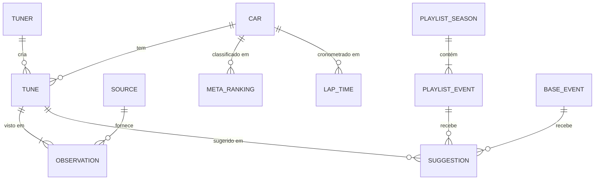

# Modelo de dados

> **Status:** rascunho v0.1 · **Atualizado em:** 2026-11-08
> A **fonte da verdade** dos tipos serão os schemas zod em `pipeline/schema/`. Este documento os descreve em linguagem humana; quando o código existir, os dois devem mudar no mesmo PR.

## 1. Convenções

| Item | Regra |
|---|---|
| IDs | Slugs estáveis em minúsculas (`a-z0-9-`). Nunca reaproveitados. Detalhes em [ADR-0006](adr/0006-identidade-canonica.md) |
| Datas | ISO 8601 em UTC (`2026-11-08T14:30:00Z`) |
| Textos traduzíveis | Objeto `{ "pt-BR": "...", "en": "..." }`. Dados do jogo (nomes de carros, eventos, tunes) **não** são traduzidos |
| Share code | Armazenado como string de 9 dígitos sem espaços (`773309331`); exibido como `773 309 331` |
| Arquivos gerados | Cada JSON gerado começa com `{ "schemaVersion": N, "generatedAt": "...", ... }` |
| Valores desconhecidos | Um valor de enum não reconhecido vira `other`, e o valor original fica em `raw` com um alerta. Nunca é descartado em silêncio |

## 2. Enumerações

| Enum | Valores | Observação |
|---|---|---|
| `CarClass` | `D` (≤400), `C` (≤500), `B` (≤600), `A` (≤700), `S1` (≤800), `S2` (≤900), `R` (≤998), `X` (999) | Limite máximo de PI de cada classe |
| `Surface` | `road`, `dirt`, `cross-country` | Equivalências nas fontes: Dirt = Rally; Cross Country = Offroad = Dirt/CC |
| `Discipline` | `circuit`, `sprint`, `street`, `touge`, `drag`, `drift`, `speed-trap`, `speed-zone`, `danger-sign`, `trailblazer`, `time-attack`, `other` | Modalidade do evento, separada do piso |
| `Drivetrain` | `FWD`, `RWD`, `AWD` | |
| `TireCompound` | `stock`, `street`, `sport`, `semi-slick`, `slick`, `super-slick`, `rally`, `offroad`, `drift`, `drag`, `other` | Lista a confirmar com o jogo; valores vistos: Stock, Street, Semi-Slicks, Slicks, Super Slicks, Rally, Offroad, Drift |
| `BuildTag` | `purist`, `stock-look`, `full-aero`, `powerbuild`, `engine-swap`, `drivetrain-swap` | Vários por tune |
| `Tier` | `meta-plus`, `meta`, `t0.5`, `t1`, `t1.5`, `t2`, `t3` | Escala da Noa Miyako; cada valor tem um `rank` numérico para ordenação |
| `Difficulty` | `easy`, `normal`, `slightly-hard`, `hard`, `very-hard` | Rótulos em chinês mapeados em `data/manual/zh-labels.yaml` |
| `Category` | `meta`, `off-meta`, `purist`, `meme` | Categorias de curadoria ([CURATION.md](CURATION.md)) |
| `SourceKind` | `google-sheet`, `google-xlsx`, `qq-doc`, `forza-official`, `manual` | |
| `Permission` | `granted`, `pending`, `denied`, `not-required` | [ADR-0010](adr/0010-politica-de-fontes.md) |
| `SourceHealth` | `healthy`, `degraded`, `failing` | |

## 3. Entidades



### Car (lista mestre)
```ts
{
  id: string                 // "1991-mazda-55-mazda-787b"
  year: number
  make: string               // "Mazda"
  model: string              // "#55 Mazda 787B"
  displayName: string        // "1991 Mazda #55 Mazda 787B"
  carTypes: string[]         // ["Classic Racers"]: categoria do jogo (pode ter mais de uma)
  country?: string
  stock?: { class: CarClass; pi: number }   // classe e PI de fábrica (ex.: "100 D")
  rarity?: Rarity            // Forza Wiki
  drivetrain?: Drivetrain    // tração de fábrica, Forza Wiki (provas "Total FWD")
  acquisition?: { raw: string /* "Autoshow, Wheelspin" */; methods: string[] /* slugs: "autoshow", "wheelspin", "autoshow-dlc"… */ }
  addOns?: string            // pacote/DLC
  sourceIds: string[]        // ids das fontes de catálogo que listam o carro
}
```

### Tuner
```ts
{
  id: string                 // "k1z-gray"
  displayName: string        // "K1Z Gray"
  team?: string              // "K1Z"
  aliases: string[]          // variações vistas nas fontes
  links?: { xbox?: string; discord?: string; youtube?: string; sheet?: string }
}
```

### Source
```ts
{
  id: string                 // "gbr-ozzy"
  name: string
  kind: SourceKind
  url: string
  ownerTunerId?: string
  tabs: { id: string; gid?: string; role: "tunes"|"catalog"|"meta"|"laptimes"|"custom-event"|"playlist" }[]
  adapter: string            // nome do arquivo em pipeline/adapters/
  permission: Permission
  active: boolean
  weight: number             // peso de confiança da fonte na curadoria (0–1)
}
```

### Tune
```ts
{
  id: string                 // "sc-773309331" ou "nc-<hash>"
  shareCode?: string         // "773309331"
  carId: string
  tunerId: string
  name: string               // nome dado pelo tunador
  class: CarClass
  pi?: number
  surface: Surface
  discipline?: Discipline
  drivetrain?: Drivetrain
  tires?: TireCompound
  engine?: string            // "4.7L V8"
  buildTags: BuildTag[]
  notes?: string
  createdAt?: string         // quando a fonte informa
  observations: Observation[]
  score?: Score              // calculado na curadoria
  categories: Category[]     // calculado na curadoria
  fromMeta?: boolean         // só existe como indicação da tabela de meta (sem código: buscar o gamertag)
  difficulty?: Difficulty    // colunas da tabela de meta, só na tune do tunador indicado
  role?: "allround" | "power" | "handling"
  metaNotes?: string         // observação da tabela (muitas vezes em chinês)
  lapRefs?: LapRef[]         // tempos citados na observação
}
```

### LapRef
```ts
{ track: string /* "Shirakawa" */; time: string /* "1:04.3" */; worldRecord?: boolean }
```

### Observation (proveniência)
```ts
{
  sourceId: string
  tab: string
  row: number
  raw: Record<string, string>  // valores originais da linha (para auditoria)
  firstSeenAt: string
  lastSeenAt: string
}
```

### MetaRanking
```ts
{ sourceId: string; tab: string; row: number; class: CarClass; surface: Surface; carId: string; tier: Tier;
  rank: number; drivetrain?: Drivetrain; difficulty?: Difficulty; tires?: TireCompound;
  role?: "allround" | "power" | "handling"; tunerIds: string[] /* tunadores recomendados */;
  shareCode?: string; notes?: string; lapRefs?: LapRef[] /* tempos citados nas notas */ }
```

### LapTime
```ts
{ sourceId: string; track: string; class: CarClass; carId: string; timeMs: number; driver: string;
  tunerId?: string; tuneName?: string; tierLabel?: string; build?: string; difficulty?: Difficulty;
  tires?: TireCompound; drivetrain?: Drivetrain; engine?: string; aero?: string; notes?: string }
```

### PlaylistSeason e PlaylistEvent
```ts
PlaylistSeason { id: string /* "s07-summer" */; series: number; seriesName: string /* "City Life" */;
                 season: "spring"|"summer"|"autumn"|"winter"; startsAt: string; endsAt: string }

PlaylistEvent {
  id: string                 // "<season-id>--<slug tipo + nome>"
  seasonId: string
  type: string               // "Championship", "Weekly Challenge", "PR Stunt - Speed Trap"...
  name: string
  reward?: string            // "Car: 1989 Toyota MR2 SC", "Credits: 25000"
  points?: number
  requirementRaw: string     // texto original de "Car / Requirement"
  requirement: {
    status: "parsed" | "unparsed" | "no-car"
    class?: CarClass
    carTypes?: string[]
    carId?: string           // quando o evento exige um carro específico
    target?: { kind: "speed"|"distance"|"time"|"score"; value: number; unit: string }
  }
  routes: { name: string; surface?: Surface; discipline?: Discipline }[]
}
```

### Suggestion
```ts
{
  eventId: string            // PlaylistEvent.id ou BaseEvent.id
  category: Category
  tuneId: string
  carId: string
  score: number
  reasons: { key: string; params?: Record<string, string|number> }[]  // chaves i18n que explicam a escolha
  origin: "rules" | "ai"
  commentary?: { "pt-BR": string; en: string }                         // só origin "ai"
}
```

### BaseEvent (manual)
```ts
{ id: string; name: string; discipline: Discipline; surface: Surface; format: "circuit"|"sprint";
  restriction: { class: CarClass; carTypes: string[] }; unlock?: string /* wristband */;
  region?: string; lengthKm?: number; laps?: number; verifiedInGameAt?: string }
```

### CustomEvent (comunidade)
```ts
{ id: string; sourceId: string; organizer: string; name: string;
  groups: { name: string /* ex.: "Tier 1 car pack (NFS Legends)" */; entries: {
    row: number; kind: "car" | "route"; label: string; carText: string; carId: string | null;
    tuneCode?: string /* tune (car) ou evento (route) */; liveryCode?: string; liveryNote?: string;
    pi?: number; adjustableAero?: boolean; drivetrain?: Drivetrain; tunedBy?: string /* tunador ou criador da rota */
  }[] }[] }
```
⏳ Descrição traduzida (`description: { "pt-BR", en }`) entra com o módulo M13.

### ChangeLogEntry
```ts
{ at: string; sourceId: string; kind: "added"|"removed"|"tier-up"|"tier-down"|"code-changed"|"moved";
  entity: { type: "tune"|"meta-ranking"|"car"; id: string }; before?: unknown; after?: unknown }
```

### ReviewItem
```ts
{ kind: "unmatched-car"|"unmatched-tuner"|"unparsed-requirement"|"unknown-enum";
  sourceId: string; raw: string; candidates?: { id: string; similarity: number }[]; firstSeenAt: string; count: number }
```

## 4. Arquivos gerados (`data/generated/`)

O mesmo conjunto de arquivos existe em dois lugares: `data/generated/` (público, só fontes autorizadas) e `.cache/preview/generated/` (todas as fontes). Ver [ARCHITECTURE §3.6](ARCHITECTURE.md#36-publicação-dos-dados).

| Arquivo | Conteúdo | Consumido por | Estado |
|---|---|---|---|
| `cars.json` | Lista mestre de carros | Todas as páginas | ✅ |
| `tuners.json` | Tunadores | Páginas de tunador, créditos | ✅ |
| `tunes/index.json` | Versão enxuta de todos os tunes (id, carro, tunador, classe, piso, tags, código, fontes) | Busca global | ✅ |
| `tunes/by-car/<carId>.json` | Tunes completos de um carro, com observações | Página de carro | ✅ |
| `laptimes.json` | Tempos de volta | Curadoria, páginas de carro | ✅ |
| `custom-events.json` | Eventos da comunidade | Módulo M13 | ✅ |
| `highlights.json` | Novidades do início: tunes atualizadas, carros novos e mudanças de tier, com `magnitude` (quanto maior o salto, maior o destaque) | Página inicial | ✅ |
| `sources-status.json` | Saúde de cada fonte | Página `/status`, alertas | ✅ |
| `meta/<source-id>.json` | Rankings de meta por fonte | Tabela de meta, curadoria | ✅ |
| `playlist/seasons.json` | Temporadas (ordem, datas, qual está ao vivo) | Página da playlist | ✅ |
| `playlist/events/<season-id>.json` | Eventos de uma temporada (ou `s07.json` para linhas de série inteira) | Página da playlist | ✅ |
| `playlist/suggestions/<season-id>.json` | Sugestões por evento (hoje só por regras) | Página da playlist | ✅ |
| `base-events.json` | Eventos-base com sugestões | Módulo M11 | ⏳ Fase 2 |
| `changelog/<AAAA-MM>.json` | Mudanças do mês | Início | ✅ |

Filas de revisão (`data/review/` e `.cache/preview/review/`):
- `unmatched-cars.json`: nomes de carro que não casaram com a lista mestre;
- `unparsed-requirements.json`: restrições da playlist que o interpretador não entendeu;
- `unknown-values.json`: pneus desconhecidos, tempos ilegíveis, share code ligado a dois carros diferentes.

Snapshots ("último dado bom", um por fonte): `data/snapshots/<source-id>.json` (fontes públicas) e `.cache/preview/snapshots/` (demais).

## 5. Regras de determinismo

- Arrays ordenados por chave estável (ex.: `id`); objetos com chaves em ordem alfabética.
- `generatedAt` só muda quando o conteúdo do arquivo muda, para não gerar commit vazio a cada execução.
- Mesmas entradas → mesmos bytes de saída. Há um teste que roda o pipeline duas vezes sobre as fixtures e compara.

## 6. Versionamento do schema

- `schemaVersion` sobe a cada mudança incompatível (campo removido ou renomeado, mudança de tipo).
- Mudanças compatíveis (campo opcional novo) não sobem a versão.
- Toda mudança incompatível é registrada em `CHANGELOG.md`, com a nota de migração.
